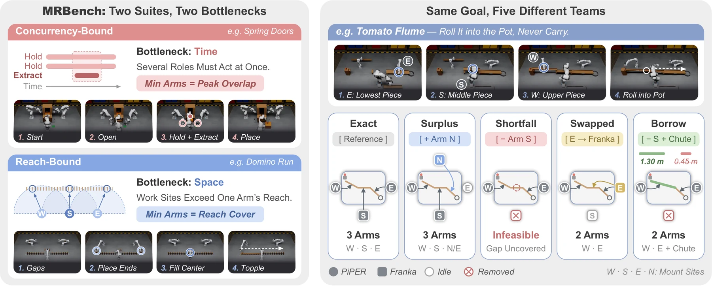
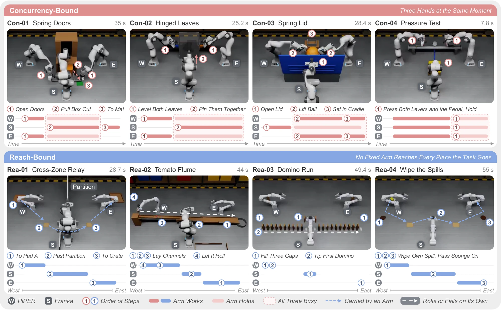

<p align="right">
  <a href="./README.md">English</a> | <b>简体中文</b>
</p>

<div align="center">

<picture>
  <source media="(prefers-color-scheme: dark)" srcset="assets/logo/logo-dark.svg">
  
</picture>

### Benchmarking Physical Necessity Reasoning in Heterogeneous Multi-Robot Manipulation

<p align="center">
<a href="https://chenanno.github.io/">Yanzhe Chen</a><sup>*</sup> &middot;
<a href="https://caozhijun.top/">Zhijun Cao</a><sup>*</sup> &middot;
<a href="https://anruihe.github.io/">Ruihe An</a><sup>*</sup> &middot;
<a href="https://github.com/seizethe-day">Chang Gong</a><sup>*</sup> &middot;
<a href="https://sites.google.com/view/showlab/home">Mike Zheng Shou</a><sup>&dagger;</sup>
</p>

<p align="center"><b>Show Lab, National University of Singapore</b></p>

<p align="center"><sup>*</sup> 共同第一作者 &nbsp;&middot;&nbsp; <sup>&dagger;</sup> 通讯作者</p>

<p align="center">
📄 论文（即将公开） &nbsp;|&nbsp;
🌐 <a href="https://showlab.github.io/MRBench/">项目主页</a>
</p>

</div>

> *"Plurality is never to be posited without necessity."* -- William of Ockham

---

## 🔥 动态

- `2026.11` MRBench **v1.0.0**：8 个 Isaac Sim 任务、每个 5 种配置，以及带 4 个基线和 oracle 参考行的对比框架。

## 📑 目录

- [🌟 概览](#-概览)
- [🧩 基准](#-基准)
- [⚖️ 基线](#️-基线)
- [🚀 快速开始](#-快速开始)
- [📂 仓库结构](#-仓库结构)
- [📌 引用](#-引用)

## 🌟 概览

**多机器人协作成功，并不说明哪些机器人是真正需要的。** 一组机械臂完成了任务，并不会告诉你其中哪几只是必需的。
MRBench 要求回答这个问题：给定目标、桌边的机械臂和桌上的物体，给出**最小支持集**（minimal support set）——
能完成任务的最少机械臂，以及能代替某只臂的物体；或者指出没有任何团队能完成，并说明缺了什么。



*出自论文。左：Concurrency 任务需要几个动作同时进行；Reach 任务需要覆盖每个工作位置。右：同一个目标，五种配置，五个不同的最小团队。*

## 🧩 基准

**8 个任务 × 5 种配置 = 40 个版本，× 每个 12 个场景（2 个难度 × 6 个种子）= 480 个场景。**

一个任务由若干 **job**（要做的事）和 **doer**（做事者）组成：doer 是固定在某个位置的某种型号机械臂，或者能接替某只臂工作的被动物体。
当不同位置的 job 必须同时进行（**Concurrency**），或超出单只臂的够达范围（**Reach**）时，任务就需要多只臂。指令只给目标，
不提任何臂、角色、步骤或工具。

| 组 | 任务 | 为什么一只臂不够 | 难度旋钮（easy / hard） |
|---|---|---|---|
| Concurrency | **Con-01** 弹簧门 | 两扇门都会弹回：各自要有人扶住，第三只手把箱子拉出来 | 箱宽 23 / 26 cm |
| | **Con-02** 铰链板 | 两块板只在都被扶平时对齐，第三只手插入销子 | 槽间隙 6 / 3 mm |
| | **Con-03** 弹簧盖 | 盖子停不住，球比手张得还宽：一只手扶盖，两只手抬球 | 盖弹簧 0.3 / 0.6 N·m/rad |
| | **Con-04** 压力测试 | 两个放气阀和脚踏阀必须同时压住 | 阀弹簧 2.0 / 3.0 N·m/rad |
| Reach | **Rea-01** 跨区接力 | 隔板把两端的臂分开：水果要经过中间的臂 | 水果 1 / 3 个 |
| | **Rea-02** 番茄滑道 | 三段滑道首尾相接，每段只有一只臂够得到 | 配合余量 6 / 3 mm |
| | **Rea-03** 多米诺 | 每个缺口只有一只臂够得到 | 间距 75 / 79 mm |
| | **Rea-04** 擦污渍 | 每块污渍只有一只臂够得到，海绵要在臂间传递 | 擦拭时间 1 / 2 s |

每个任务有五种**配置**：目标不变，桌上的 doer 变化，正确答案随之变化。除参考配置外，每种配置都针对一种不做测量的捷径。

| 配置 | 桌上有什么 | 正确答案 | 针对的捷径 |
|---|---|---|---|
| **exact** | 任务自身的三只臂 | 三只都要 | -- |
| **surplus** | 多一只臂：北侧的 Franka | 四只臂中最少的组合，没用到的闲置 | 有臂就用 |
| **shortfall** | 去掉一只必需的臂 | 不可行，并指出哪个 job 没人做 | 默认可行 |
| **swapped** | 一只臂换成另一种型号 | 换型后的最少团队，或不可行 | 按位置分配角色 |
| **borrow** | 去掉一只必需的臂，加一个能顶替它的道具和一个外观相近但不能的干扰物 | 剩下的臂加道具 | 凭外观替代 |



*出自论文。每个任务在其脚本参考执行中的关键时刻（exact，easy），以及步骤顺序和各臂何时（Concurrency）或何处（Reach）工作。*

机械臂有 Franka Emika Panda、AgileX PiPER 和 SO-101 三种，固定在同一张桌子边的三个位置——西、南、东，北侧留给 surplus
的那只臂。每个版本有 12 个**场景**：两个难度、六个种子；种子决定房间（厨房、工作间或家）、给任务物体换色，并加三件日常物品。
标准答案由带余量的逆运动学和最小可行团队的精确搜索算出，每个可行的标准团队都在 Isaac Sim 中执行成功。成功与否只看物体状态，
不看方法自己怎么说。每个任务和版本的完整说明见 [docs/TASKS.md](docs/TASKS.md)。

**指标。** *团队选择准确率*：答案的可行性、所用臂和物体都与标准答案一致。*任务级准确率*（主指标）：96 个任务场景（某任务在某难度和种子下）
中五种配置全部正确的比例。*SR* 和 *MSS-SR*：答案在 Isaac Sim 中执行成功；用正确的团队执行成功。工具、设定和评分见
[docs/PROTOCOL.md](docs/PROTOCOL.md)。

## ⚖️ 基线

所有方法拿到相同的信息、工具和答案格式，并把答案交给同一个共享执行器。每个已有方法只改它的输入和输出，不改它的推理方式
（[docs/BASELINES.md](docs/BASELINES.md)）。

| 行 | 方法 |
|---|---|
| `llm-solver` | **LLM + solver**：模型把场景翻译成 job、分组和 doer，精确搜索数出臂数 |
| `smart-llm` | **SMART-LLM-style**（[Kannan et al.](https://arxiv.org/abs/2309.10062)）：分解、组建联盟、分配 |
| `roco` | **RoCo-style**（[Mandi et al.](https://arxiv.org/abs/2307.04738)）：每只臂一个模型，对话直到全部同意 |
| `hmas2` | **HMAS-2-style**（[Chen et al.](https://arxiv.org/abs/2309.15943)）：中心规划者提方案，每只臂接受或否决 |
| `oracle-script`、`oracle-team` | 参考：标准团队的脚本参考执行；把标准团队交给共享执行器 |

## 🚀 快速开始

核心部分（任务卡、场景构建、评分、无物理的 mock 引擎和对比框架）只需要 Python 3.10+：

```bash
pip install -e ".[dev]"
mrbench validate                         # 检查所有设计规则，不需要 GPU
mrbench tasks                            # 8 个任务
mrbench show Con-01                      # 任务卡和构建好的场景
mrbench brief Con-01 --pretty            # 方法会被告知的内容
mrbench run Con-01 --engine mock --policy oracle
```

结果来自 **Isaac Sim 4.5 + Isaac Lab 2.1**，需要单独的环境（[docs/GETTING_STARTED.md](docs/GETTING_STARTED.md)）：

```bash
pip install -e ".[isaac]"                # 装进 Isaac Sim 的解释器
mrbench assets fetch && mrbench assets convert && mrbench assets looks && mrbench doctor
mrbench demo Con-01                      # 脚本参考执行的视频
mrbench snapshot --scenes paper          # 每个场景的相机画面和机械臂状态
```

然后在 480 个场景上评测并汇总：

```bash
mrbench methods                                              # 所有行
mrbench evaluate --run main --methods main --scenes paper --setting one-shot \
                 --backend openai --base-url <URL> --model <MODEL>
mrbench evaluate --run main-exec --setting exec --plans-from <ANSWERS.jsonl>   # 执行答案
mrbench table --run main
```

`--backend` 可选 `openai`（任何 OpenAI 兼容接口）、`api`（Anthropic Messages API，需 `pip install -e ".[api]"`）或
`claude`（关闭自带工具的 Claude Code 命令行）。密钥从环境变量读取，不放在仓库里的任何文件中。

## 📂 仓库结构

```
mrbench/      基准：任务卡及其代码、场景、机器人、引擎（Isaac、mock）、评分、运行器，
              以及对比框架（agent/：环境、工具、执行器、评分、基线）
docs/         任务详解、协议、基线、快速上手、架构
tests/        测试（`pytest`）
assets/       logo 和论文配图
```

边界和设计规则见 [docs/ARCHITECTURE.md](docs/ARCHITECTURE.md)。

## 📌 引用

如果用到 MRBench，请引用论文：

```bibtex
@article{chen2026mrbench,
  title={MRBench: Benchmarking Physical Necessity Reasoning in Heterogeneous Multi-Robot Manipulation},
  author={Chen, Yanzhe and Cao, Zhijun and An, Ruihe and Gong, Chang and Shou, Mike Zheng},
  journal={arXiv preprint arXiv:},
  year={2026}
}
```

## 📄 许可与致谢

代码采用 Apache License 2.0（`LICENSE`、`NOTICE`）。仓库不分发任何素材：机器人模型、贴图和扫描物体都在你的机器上下载，
按各自的许可使用，见 `CREDITS.md`。用它们渲染的图片和视频须注明出处。
