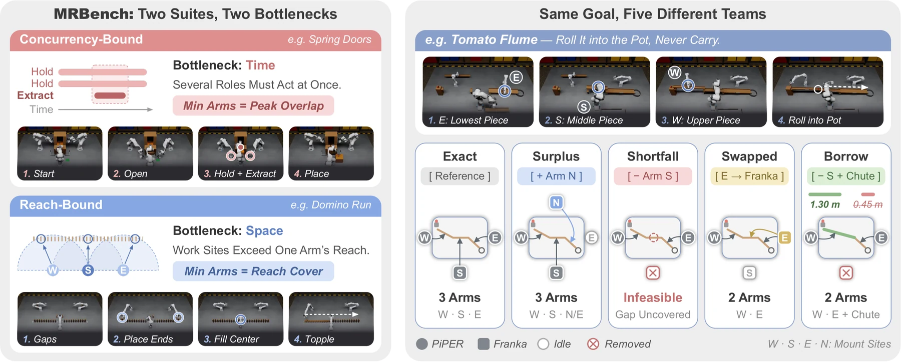

<p align="right">
  <b>English</b> | <a href="./README-zh.md">简体中文</a>
</p>

<div align="center">

<picture>
  <source media="(prefers-color-scheme: dark)" srcset="assets/logo/logo-dark.svg">
  
</picture>

### Benchmarking Physical Necessity Reasoning in Heterogeneous Multi-Robot Manipulation

<p align="center">
<a href="https://chenanno.github.io/">Yanzhe Chen</a><sup>*</sup> &middot;
<a href="https://caozhijun.top/">Zhijun Cao</a><sup>*</sup> &middot;
<a href="https://anruihe.github.io/">Ruihe An</a><sup>*</sup> &middot;
<a href="https://github.com/seizethe-day">Chang Gong</a><sup>*</sup> &middot;
<a href="https://sites.google.com/view/showlab/home">Mike Zheng Shou</a><sup>&dagger;</sup>
</p>

<p align="center"><b>Show Lab, National University of Singapore</b></p>

<p align="center"><sup>*</sup> equal contribution &nbsp;&middot;&nbsp; <sup>&dagger;</sup> corresponding author</p>

<p align="center">
📄 Paper (coming soon) &nbsp;|&nbsp;
🌐 <a href="https://showlab.github.io/MRBench/">Project Page</a>
</p>

</div>

> *"Plurality is never to be posited without necessity."* -- William of Ockham

---

## 🔥 News

- `2026.11` MRBench **v1.0.0**: eight Isaac Sim tasks in five configurations each, and the comparison framework with
  four baselines and the oracle rows.

## 📑 Contents

- [🌟 Overview](#-overview)
- [🧩 The benchmark](#-the-benchmark)
- [⚖️ Baselines](#️-baselines)
- [🚀 Quick start](#-quick-start)
- [📂 Repository layout](#-repository-layout)
- [📌 Citation](#-citation)

## 🌟 Overview

**Successful coordination does not reveal which robots are actually needed.** A team of arms can finish a task
without telling you which of them it needed. MRBench asks for that: given the goal, the arms around the table and the
objects on it, name the **minimal support set** -- the fewest arms, and any object standing in for one, that can do
the task -- or say that no team can, and what is missing.



*From the paper. Left: Concurrency tasks need several actions at the same moment; Reach tasks need every work site
covered. Right: one goal, five configurations, five different minimal teams.*

## 🧩 The benchmark

**8 tasks × 5 configurations = 40 versions, × 12 scenes (2 levels × 6 seeds) = 480 scenes.**

A task is a set of **jobs** done by **doers**: arms, each a robot model at a fixed place, and passive objects that
can take over a job from an arm. A task needs several arms when jobs at different places must happen at once
(**Concurrency**) or lie beyond one arm's reach (**Reach**). The instruction gives only the goal: no arm, role, step
or tool.

| Suite | Task | Why one arm is not enough | Knob (easy / hard) |
|---|---|---|---|
| Concurrency | **Con-01** spring doors | both doors spring shut: each is held open while a third hand draws the box out | box width 23 / 26 cm |
| | **Con-02** hinged leaves | two leaves line up only while both are held level; a third hand slides the pin in | slot clearance 6 / 3 mm |
| | **Con-03** spring lid | the lid stays open at no angle and the ball is wider than a hand: one holds, two lift | lid spring 0.3 / 0.6 N·m/rad |
| | **Con-04** pressure test | both bleed valves and the foot valve must be held down at once | valve spring 2.0 / 3.0 N·m/rad |
| Reach | **Rea-01** cross-zone relay | a partition keeps the end arms apart: the fruit passes through the middle arm | fruit 1 / 3 pieces |
| | **Rea-02** tomato flume | three channels are laid end to end, each where only one arm reaches it | fit room 6 / 3 mm |
| | **Rea-03** domino run | each gap in the line is within one arm's reach only | spacing 75 / 79 mm |
| | **Rea-04** wipe the spills | each spill is within one arm's reach; the sponge goes from arm to arm | wipe time 1 / 2 s |

Each task comes in five **configurations** that keep the goal and change the doers on the table, and with them the
right answer. Each but the reference defeats a shortcut that skips measuring.

| Configuration | On the table | Right answer | Defeats |
|---|---|---|---|
| **exact** | the task's three arms | all three | -- |
| **surplus** | a fourth arm, a Franka at north | the fewest arms of the four; any arm left out idle | staffing by presence |
| **shortfall** | one needed arm removed | infeasible, with the job left without a doer | presumed feasibility |
| **swapped** | one arm replaced by another robot model | the fewest arms with it, or infeasible | roles by place |
| **borrow** | one needed arm removed; a prop that can do its job and a look-alike distractor that cannot | the remaining arms with the prop | substitution by appearance |


*From the paper. Each task at a key moment of its scripted reference (exact, easy), with its steps in order and when
(Concurrency) or where (Reach) each arm works.*

The arms are Franka Emika Panda, AgileX PiPER and SO-101, at three fixed places round one table -- west, south and
east, with north for the surplus arm. Each version has 12 **scenes**: two levels and six seeds; the seed picks the
room (a kitchen, a workshop or a home), recolours the task's objects and adds three everyday objects. Gold answers
are computed from inverse kinematics with margins and an exact search for the smallest feasible teams, and every
feasible gold team succeeds in Isaac Sim. Success is judged from the objects' states, never from what a method
claims. [docs/TASKS.md](docs/TASKS.md) has every task and version in full.

**Metrics.** *Team-selection accuracy*: the answer's feasibility, arms and objects all match the gold answer.
*Task-level accuracy* (the headline): the share of the 96 task-scenes, a task at one level and seed, with all five
configurations right. *SR* and *MSS-SR*: the answer carried out in Isaac Sim succeeds; it succeeds with a right team.
[docs/PROTOCOL.md](docs/PROTOCOL.md) gives the tools, the settings and the scoring.

## ⚖️ Baselines

Every method gets the same information, tools and answer form, and hands its answer to one shared executor. Each
prior method is adapted only in what it takes in and gives out, never in how it reasons
([docs/BASELINES.md](docs/BASELINES.md)).

| Row | Method |
|---|---|
| `llm-solver` | **LLM + solver**: the model translates the scene into jobs, groups and doers; exact search counts the arms |
| `smart-llm` | **SMART-LLM-style** ([Kannan et al.](https://arxiv.org/abs/2309.10062)): decomposition, coalition formation, allocation |
| `roco` | **RoCo-style** ([Mandi et al.](https://arxiv.org/abs/2307.04738)): one model per arm, in dialogue until all agree |
| `hmas2` | **HMAS-2-style** ([Chen et al.](https://arxiv.org/abs/2309.15943)): a central planner proposes, each arm accepts or vetoes |
| `oracle-script`, `oracle-team` | references: the gold team's scripted reference; the gold team handed to the shared executor |

## 🚀 Quick start

The core -- task cards, scene building, scoring, a physics-free mock engine and the comparison framework -- needs
only Python 3.10+:

```bash
pip install -e ".[dev]"
mrbench validate                         # every design rule, no GPU
mrbench tasks                            # the eight tasks
mrbench show Con-01                      # a task's card and a built scene
mrbench brief Con-01 --pretty            # what a method is told about a scene
mrbench run Con-01 --engine mock --policy oracle
```

Results come from **Isaac Sim 4.5 + Isaac Lab 2.1**, in their own environment
([docs/GETTING_STARTED.md](docs/GETTING_STARTED.md)):

```bash
pip install -e ".[isaac]"                # into the Isaac Sim interpreter
mrbench assets fetch && mrbench assets convert && mrbench assets looks && mrbench doctor
mrbench demo Con-01                      # a video of the scripted reference
mrbench snapshot --scenes paper          # every scene's camera pictures and arm state
```

Then evaluate methods on the 480 scenes and tabulate them:

```bash
mrbench methods                                              # the rows
mrbench evaluate --run main --methods main --scenes paper --setting one-shot \
                 --backend openai --base-url <URL> --model <MODEL>
mrbench evaluate --run main-exec --setting exec --plans-from <ANSWERS.jsonl>   # carry the answers out
mrbench table --run main
```

`--backend` is `openai` (any OpenAI-compatible endpoint), `api` (the Anthropic Messages API, `pip install -e ".[api]"`)
or `claude` (the Claude Code CLI with its own tools switched off). Keys are read from the environment, never from a
file in the repository.

## 📂 Repository layout

```
mrbench/      the benchmark: task cards and their code, scenery, robots, engines (Isaac, mock), scoring, runner,
              and the comparison framework (agent/: environment, tools, executor, grading, baselines)
docs/         the tasks in full, the protocol, the baselines, getting started, the architecture
tests/        the test suite (`pytest`)
assets/       the logo and the paper's figures
```

[docs/ARCHITECTURE.md](docs/ARCHITECTURE.md) explains the boundaries and the design rules.

## 📌 Citation

If you use MRBench, please cite the paper:

```bibtex
@article{chen2026mrbench,
  title={MRBench: Benchmarking Physical Necessity Reasoning in Heterogeneous Multi-Robot Manipulation},
  author={Chen, Yanzhe and Cao, Zhijun and An, Ruihe and Gong, Chang and Shou, Mike Zheng},
  journal={arXiv preprint arXiv:},
  year={2026}
}
```

## 📄 Licence and credits

The code is under the Apache License 2.0 (`LICENSE`, `NOTICE`). No asset is distributed with it: robots, textures and
scanned objects are fetched on your machine and used under their own licences, listed in `CREDITS.md`. Pictures and
videos rendered with them must carry that credit.
