# The tasks

The [README](../README.md) has the overview. This page has each of the eight tasks in full: its instruction, its arms,
its two levels, why one arm is not enough, its scripted reference, its success predicate and the gold answer of each
of its five configurations. [PROTOCOL.md](PROTOCOL.md) says what a method is given and how it is scored.

## What every task shares

**The table and its places.** Every task uses one table, 3.2 m long (west to east, x) and 1.8 m wide (y), its top at
z = 0.75 m, and the same three places (`mrbench/tasks/layouts.py`). The **west** (W) and **east** (E) arms face each
other along the table's length, 1.4 m apart, each 0.9 m in from its end; the **south** (S) arm stands at the middle of
the south side, 20 cm in from its edge, facing north. Each base axis is 0.70 m from the table's centre. An arm is named
by its place; which robot stands there is the task's choice. The `surplus` configuration adds a fourth arm, a Franka,
on the **north** (N) side.

**The robots.**

| robot | name in code | arm joints | nominal reach | fingers |
|---|---|---|---|---|
| Franka Emika Panda | `panda` | 7 | 0.855 m | parallel, open to 8 cm |
| AgileX PiPER | `piper` | 6 | 0.626 m | parallel, open to 7 cm |
| SO-101 | `so101` | 5 | 0.38 m | a jaw |

The Panda comes from Isaac Lab; the PiPER and the SO-101 are converted from URDFs pinned by commit
(`mrbench/robots/sources.yaml`). Every arm carries a wrist camera (a RealSense D405 on a bracket on the front of the
hand, looking along the fingers); six fixed cameras look at the table from above, from the south-east and from each
side.

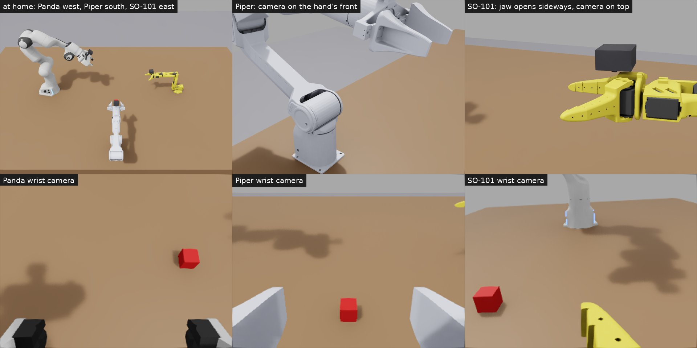

**Levels.** Each task has an **easy** and a **hard** level that differ in one parameter, the task's *knob*.

**Configurations and versions.** A task comes in five configurations that change only who and what is on the table;
a task in a configuration is a **version** (8 x 5 = 40):

| configuration | the table | the shortcut it defeats |
|---|---|---|
| `exact` | the task's three arms, all needed | -- |
| `surplus` | the three and a Franka on the north side | staffing by presence |
| `shortfall` | one needed arm taken away: no team is feasible | presumed feasibility |
| `swapped` | one arm replaced by another robot on the same place | roles by place |
| `borrow` | one needed arm taken away, and a **prop** that can do its job and a **distractor** that cannot, alike but for one measured property | substitution by appearance |

**Scenes.** A scene is a version at a level and a seed. The main experiments use the 480 **varied** scenes (8 tasks x
5 configurations x 2 levels x seeds 0-5): the seed picks the room by `seed % 3` (a kitchen, a workshop, a home with a
cream cloth on the table), repaints the task's painted objects (and every word that names them: instruction, facts,
descriptions), adds three everyday objects within the arms' reach (a book, a pen, a notepad, a paper cup, a mug, a can
of soup, a box of tea; never where the reference works, never able to do an arm's job), shifts the task's objects by
at most 1.6 cm, and in `borrow` draws where the prop and the distractor stand and, where the distractor can fail
either way, whether it is the larger or the smaller. The **default scene** of a version is easy, seed 0, in the card's
look. A scene's id is `<version>@<level>.s<seed>.varied`, e.g. `Con-01-borrow@hard.s3.varied`; the version id alone
(`Con-01-borrow`) is the default scene. The gold answer of a version is the same in all its scenes.

**Grasps.** Fixed arms move only through joint targets. A grip is privileged: a body within 2 cm of the closing
fingers is fixed to the hand, but only if it fits between the open fingers, unless a second hand presses on its far
side. Everything else -- springs, weights, rolling, falling -- is physics.

**Success** is a predicate over the objects' recorded states, never what a method reports. A run lasts at most the
card's time limit (`horizon_s`, with a longer limit for a configuration whose team does more).

**Instructions** give only the goal: no arm, role, step or tool. Three also bound the process: Rea-02's tomato must
roll, not be carried; Rea-03's line must be whole when it is set off; Rea-04's sponge must stay on each spill for the
wipe time. The gold answers are smallest under these bounds.

## The eight at a glance

| task | suite | W / S / E | knob: easy -> hard | why one arm is not enough |
|---|---|---|---|---|
| [Con-01 spring doors](#con-01-spring-doors) | Concurrency | Franka / Franka / Franka | box width 23 -> 26 cm | two doors held open while a third hand draws the box out |
| [Con-02 hinged leaves](#con-02-hinged-leaves) | Concurrency | Franka / Franka / Franka | slot clearance 6 -> 3 mm | two leaves held level while a third hand slides the pin |
| [Con-03 spring lid and basketball](#con-03-spring-lid-and-basketball) | Concurrency | Franka / Franka / Franka | lid spring 0.3 -> 0.6 N m/rad | the lid held open while two hands take the ball |
| [Con-04 pressure test](#con-04-pressure-test) | Concurrency | Franka / Franka / Franka | bleed valve spring 2.0 -> 3.0 N m/rad | two levers and a pedal held down at once |
| [Rea-01 cross-zone relay](#rea-01-cross-zone-relay) | Reach | PiPER / Franka / PiPER | fruit 1 -> 3 pieces | the end arms share no place; fruit passes through the middle arm |
| [Rea-02 tomato flume](#rea-02-tomato-flume) | Reach | PiPER / Franka / PiPER | channel fit 6 -> 3 mm | each channel starts where only one arm reaches it |
| [Rea-03 domino run](#rea-03-domino-run) | Reach | PiPER / PiPER / PiPER | spacing 75 -> 79 mm | each gap in the line is within one arm's reach only |
| [Rea-04 wipe the spills](#rea-04-wipe-the-spills) | Reach | PiPER / PiPER / PiPER | wipe time 1 -> 2 s | each spill is within one arm's reach only |

In the **Concurrency** tasks three hands are needed at once, one more than a two-handed robot has. In the **Reach**
tasks no two arms act at once, but no fixed arm reaches every place: bodies pass from arm to arm by being set down, or
each arm works where only it reaches.

## The gold answers at a glance

A gold answer is every minimal support set (any one is right), or **infeasible** with the jobs left without a doer.
`swapped` names the robot put in; `borrow` names the prop and, in brackets, the distractor.

| task | exact | surplus | shortfall (arm removed) | swapped | borrow (arm removed) |
|---|---|---|---|---|---|
| Con-01 | W S E | W S E | infeasible (E): east door, drawing the box | infeasible (S -> PiPER): drawing the box | W S + 9 cm counterweight (4 cm) (E) |
| Con-02 | W S E | W S E, W N E or W S N | infeasible (W): the blue leaf | infeasible (W -> SO-101): the blue leaf | S E + chock (2 cm lower, or 32 cm wide) (W) |
| Con-03 | W S E | W S E | infeasible (S): the lid and the ball | infeasible (W -> PiPER): the ball | W E + 0.72 m prop rod (12 cm longer or shorter) (S) |
| Con-04 | W S E | W S E, N S E, W N E or W S N | infeasible (S): three holds, two arms | infeasible (W -> SO-101): the west valve | W E + 4.8 cm test weight (2.4 cm) (S) |
| Rea-01 | W S E | W N | infeasible (S): the carry past the partition | infeasible (W -> SO-101): the carry | W E + 67 cm paddle (16 cm, or a 12 cm rim) (S) |
| Rea-02 | W S E | W S E or W S N | infeasible (S): the middle channel | W E (E -> Franka) | W E + 1.30 m chute (0.45 m) (S) |
| Rea-03 | W S E | W S E | infeasible (S): places 12-14 | infeasible (S -> SO-101): places 12 and 14 | W E + 30 cm slat (24 or 36 cm) (S) |
| Rea-04 | W S E | W S E | infeasible (S): the middle spill | W E (E -> Franka) | W E + sponge brush (clip too narrow or too wide) (S) |

`shortfall` and `borrow` remove the same arm. 14 of the 40 versions are infeasible.

Print any version's answer, at any level and seed:

```bash
python -c "from mrbench.agent.cases import make_case; print(make_case('Con-01', 'borrow', 'hard', 3).expect)"
python -m mrbench.tasks.jobs show Con-04 --variant surplus     # who can do each job, and the answer
```

## Jobs and how the gold answers are computed

A task is a set of **jobs** done by **doers** (`mrbench/tasks/jobs.py`; each impl declares its jobs in `jobs(inst)`).

- A job has **sites**, the poses where a hand must act (a named point of the instance, an explicit point, or any one
  of several points: a bar held anywhere along it), a **margin** and possibly a **group**: the jobs of one group must
  happen at the same time.
- An **act** job needs one arm that reaches every site; a **carry** job moves a body from one site to another, by one
  arm that reaches both or by a chain of arms in which each meets the next at a hand-over point.
- An arm **reaches** a site with margin when inverse kinematics puts its tool point there with the hand pointing
  down or away from its base, its links 1 cm clear of the table and out of every fixed body, and still does so with
  the point moved by the margin. Two arms **meet** when both reach a place between their bases from their own sides,
  clear of the fixed bodies.
- A **prop** does a set of jobs once in place; putting it there is a job of its own for an arm. A distractor does
  none, and its declaration names the property that keeps it from working.
- A team is **feasible** when every job (with the props it uses and their placing jobs) gets a doer from the team and
  the jobs of a group get different doers. The **minimal support sets** are the feasible teams of least size; the task
  is infeasible when the whole table is not feasible, and the answer then names the jobs that cannot all have a doer.

The solver tries every subset of arms from the smallest up and every subset of things; the inverse-kinematics results
it rests on are kept in `mrbench/tasks/facts/<task>.json` and the answers of all 480 scenes in
`mrbench/agent/gold.json` (`python -m mrbench.tasks.jobs gold --check` compares them offline). The model rests on
reach and on which jobs must happen at once; where reach alone cannot decide a claim that an arm is needed, the claim
is checked by playing the task in Isaac.

Each job also has a **failure signal** (`mrbench/tasks/signals.py`): what a run shows when the job was tried and
could not be carried through (a door that swung shut with the box still inside). It is what a failure report names;
a grip that closed on nothing or an arm behind its plan is not one.

## The pictures

Each strip shows the scene at seed 0 at both levels: the start (built, every arm held at home for 1 s of physics),
and the goal (every object at its last keyframe, the arms at home: what success looks like); some also show a moment
in between. `<ID>-top.jpg` looks straight down from 4 m. `mrbench render` makes them
again (Isaac).

---

## Con-01 spring doors

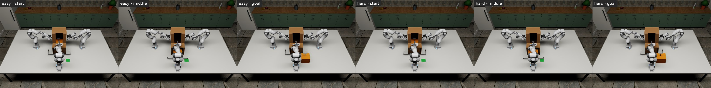

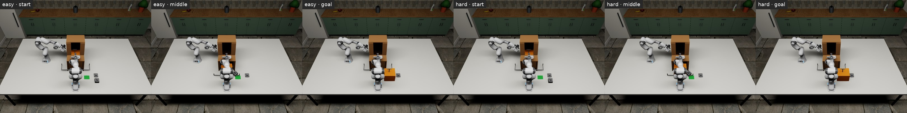

Top views: [exact](media/tasks/Con-01-top.jpg), [borrow](media/tasks/Con-01-borrow-top.jpg).

**Instruction.** *"Take the orange box out of the cabinet and set it on the green mat, with both doors closed."* The
colour words follow the seed in varied scenes.

**Arms.** W Franka, S Franka, E Franka. **Knob:** the box's width, 23 cm (easy) or 26 cm (hard). **Time limit:** 70 s
(borrow 120 s).

**Facts told.** Each door has a spring; let go, it swings shut. The doors open inward; each is opened and held by its
lever's knob, outside the cabinet.

**The scene and why one arm is not enough.** A cabinet stands across the middle of the table, its doorway facing S.
In front, two spring doors as high as the box open inward under a fixed ceiling; each is worked by a low lever outside
it, a bar beside the side wall with a knob. The box is wider than one door's way and deeper and taller than the slot
over the ceiling, so no turning gets it out: both doors must be held open while a third hand draws the box out by its
T-handle, whose post runs in a narrow slot in the ceiling. The ceiling and the T-handle keep every link of the
retriever clear of the doors. Neither end arm reaches the other's knob, and the box's 23-26 cm face is wider than any
hand opens.

**Scripted reference.** W and E each take their knob from above, swing the lever round and hold their door at 88°; S
reaches in through the slot, takes the box by its handle and draws it out under the ceiling, takes it again from
straight above and draws it out through the doors, holds it up while the doors close under it, and sets it on the
mat.

**Success.** The box has left the cabinet and rests on the mat with both doors closed, for 1 s and to the end of the
run.

**Jobs** (margin 2 cm). Hold the west door open by its knob; hold the east door open by its knob; draw the box out
between the open doors by its handle -- these three in one group -- and set the box on the mat (a carry). Failure
signal of a door: it swung shut with the box still inside.

| configuration | the table | gold answer |
|---|---|---|
| exact | W S E | W S E |
| surplus | + N Franka at (0, 0.70), facing south, clear of the cabinet | W S E: N reaches neither knob nor the handle |
| shortfall | E removed | infeasible: hold the east door open; draw the box out (S reaches the east knob, but then no hand draws the box) |
| swapped | S becomes a PiPER | infeasible: a PiPER on the south place cannot draw the box out, and no other arm can |
| borrow | E removed; two cast-iron counterweights on rubber pads with a lifting handle | W S + the 9 cm counterweight: set in the east lever's way back, its bar (5 cm up) cannot swing back past it; the 4 cm one lets the bar pass over it and the door shuts |

## Con-02 hinged leaves

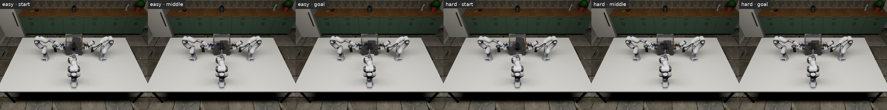

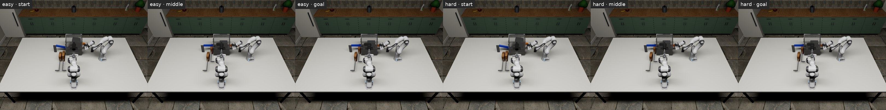

Top views: [exact](media/tasks/Con-02-top.jpg), [borrow](media/tasks/Con-02-borrow-top.jpg).

**Instruction.** *"Pin the blue and the orange leaf together through all their slots with the grey pin, so that they
hold each other level between their posts."* The colour words of the leaves follow the seed in varied scenes.

**Arms.** W Franka, S Franka, E Franka. **Knob:** the room each side of the pin's key in a slot, 6 mm (easy) or 3 mm
(hard). **Time limit:** 45 s (borrow 60 s).

**Facts told.** Each leaf turns on a hinge at its post; let go, the blue leaf hangs down and the orange leaf springs
up. The pin is a flat key; each slot fits it only lying flat.

**The scene and why one arm is not enough.** Two leaves hinged on posts west and east meet in the air as a clevis
inside a glass guard: the west leaf ends in a tongue, the east one in a fork, all three slotted. The slots line up only
while both leaves are held level. Each leaf enters the guard through a slot in its side wall, and only the arm at its
end reaches its bar; the pin goes in through a small opening in the south wall. Hinges and guard leave no two-arm
route (pinning the parts on the table and lifting them): no other arm reaches a leaf, and one arm holding both comes
no nearer than 17 cm. Pinned, the leaves hold each other level.

**Scripted reference.** W and E each take their leaf's bar and turn it level; S takes the pin by its head and slides it
through the opening and the three slots while the end arms hold on.

**Success.** The pin's key runs through all three slots and both leaves are level within 3°, for 1 s.

**Jobs** (margin 2 cm), all in one group. Hold the blue leaf level by its bar; hold the orange leaf level by its bar;
slide the pin home through the three slots. Failure signals: a leaf, once level, dropped before the pin was through;
the pin was pushed in while a leaf hung out of line.

| configuration | the table | gold answer |
|---|---|---|
| exact | W S E | W S E |
| surplus | + N Franka at (0.35, 0.65), facing east, clear of the guard | any of W S E, W N E, W S N: N can hold the orange leaf in E's place, and E can then slide the pin in S's; only W reaches the blue leaf |
| shortfall | W removed | infeasible: hold the blue leaf level (no arm but W reaches its bar) |
| swapped | W becomes an SO-101 | infeasible: the SO-101 reaches no part of the blue leaf's bar, and no other arm does |
| borrow | W removed; two yellow polymer lifting wedges shaped like wheel chocks, with a 25° ramp and a handle | S E + the chock whose flat top sits 0.8 mm under the bar held level: pushed under the hanging bar outside the guard, it holds the blue leaf level. The distractor, by the seed, is 2 cm lower (the bar rests 4° low or more) or 32 cm wide (wider than the 25.5 cm between the post's plate and the guard) |

## Con-03 spring lid and basketball

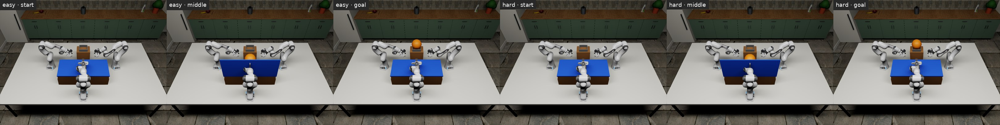

Top view: [exact](media/tasks/Con-03-top.jpg).

**Instruction.** *"Take the orange ball out of the box with the spring lid and set it in the cradle north of the
box."* The ball's colour follows the seed in varied scenes.

**Arms.** W Franka, S Franka, E Franka. **Knob:** the lid's spring, 0.3 N m/rad (easy) or 0.6 N m/rad (hard).
**Time limit:** 60 s.

**Facts told.** The lid is on a spring; let go, it swings shut. The box's inner walls are slick.

**The scene and why one arm is not enough.** A long box (1.0 x 0.44 m) with slick, lipped inner walls holds a 22 cm
ball, wider than any hand opens (8 cm). Its lid, hinged along the south edge on a spring, has no angle at which it
stays open. One hand holds the lid open while two others take the ball between them and set it in a cradle 54 cm
north.

**Scripted reference.** S opens the lid upright by its tab; W and E press their closed fingertips into the ball's
sides, lift it and carry it to the cradle; S lets the lid down.

**Success.** The ball sits in the cradle for 1 s and to the end of the run.

**Jobs** (margin 2 cm), all in one group. Hold the lid open by its tab; lift the ball by its west side into the
cradle; lift the ball by its east side into the cradle. Failure signals: the lid fell shut with the ball still in the
box; once lifted over the wall, the ball fell back outside the cradle.

| configuration | the table | gold answer |
|---|---|---|
| exact | W S E | W S E |
| surplus | + N Franka at (0, 0.55), facing east | W S E: N can hold the lid only while it is nearly shut, and reaches neither side of the ball over the box |
| shortfall | S removed | infeasible: the lid held and the ball taken between two hands, three hands at once with two arms |
| swapped | W becomes a PiPER | infeasible: the PiPER reaches neither side of the ball in the box, and two hands must lift it |
| borrow | S removed; two black steel prop rods with a hook and a pivoting foot in a socket south of the box | W E + the rod whose hook is 0.72 m from its pivot, swung over the lid's edge by the end arms to hold the lid open. The distractor is 12 cm longer (its hook passes beyond the free edge) or 12 cm shorter (it never reaches it), by the seed |

## Con-04 pressure test

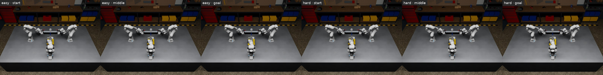

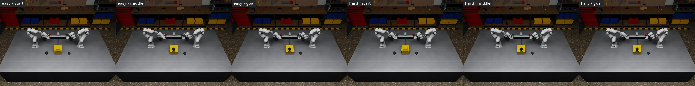

Top views: [exact](media/tasks/Con-04-top.jpg), [borrow](media/tasks/Con-04-borrow-top.jpg).

**Instruction.** *"Hold the steel pipe at its test pressure for a second: both bleed valves shut while the foot valve
lets air in."*

**Arms.** W Franka, S Franka, E Franka. **Knob:** each bleed valve's spring, 2.0 N m/rad (easy) or 3.0 N m/rad (hard).
**Time limit:** 30 s (borrow 45 s).

**Facts told.** Each bleed valve has a spring; let go, its lever lifts and the valve opens. The foot valve has a
spring; held down it lets air in, let go it rises and shuts.

**The scene and why one arm is not enough.** A steel test pipe lies east-west on two stands with a pressure gauge on
top and takes its air through a hose from a foot valve in front of S. It holds its test pressure only while both
bleed valves are shut and the foot valve lets air in. Each bleed valve shuts while its lever on the pipe's top is
pressed down, and a spring lifts it again when let go; the foot valve's pedal likewise rises and shuts when let go.
Each lever's grip is reached only by the arm at its end of the table (S is 1.04 m from either, the far end arm
1.02 m), and with the end arms on the levers no hand is left for the pedal.

**Scripted reference.** W and E each press their lever's grip down, S presses the pedal's toe bar down, and all three
hold for the test.

**Success.** Both levers and the pedal are held down at once for 1 s.

**Jobs** (margin 2 cm), all in one group. Shut the west bleed valve: hold its lever down by its grip; shut the east
bleed valve likewise; let air in: hold the foot valve's pedal down by its toe bar. Failure signals: a bleed valve, once
shut, opened again while air came in; the pedal, once down, rose while both valves were shut; a weight set in the
pedal's pocket left it up.

| configuration | the table | gold answer |
|---|---|---|
| exact | W S E | W S E |
| surplus | + N Franka at (0, 0.70), facing south, back from the pipe | any three hands, one on each lever and one on the pedal: W S E, N S E, W N E or W S N (N reaches either lever's grip, not the pedal; an end arm whose lever N holds reaches the pedal). The four teams share no arm |
| shortfall | S removed | infeasible: each hold has an arm that can do it, but the three must happen at once and two arms remain |
| swapped | W becomes an SO-101 | infeasible: the SO-101 does not reach the west lever's grip, and no other arm does |
| borrow | S removed; two steel test weights, 9 cm round, with a knob on top | W E + the 4.8 cm, 2.4 kg weight: set in the pocket on the pedal by an end arm, it holds the pedal down against its spring. The distractor is half as tall (2.4 cm, 1.2 kg): in the pocket the pedal does not move |

## Rea-01 cross-zone relay

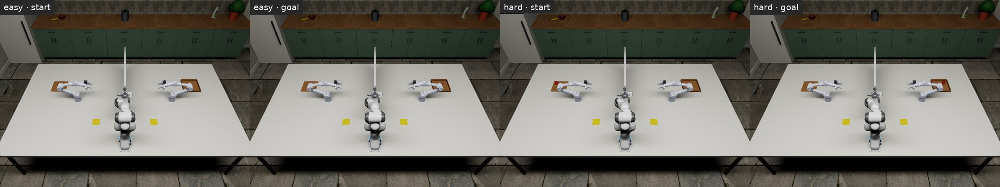

Top view: [exact](media/tasks/Rea-01-top.jpg).

**Instruction.** *"Move the apple from the start area at the far west end of the table into the crate at the far east
end."* At the hard level it names the count: *"Move the 3 pieces of fruit ..."*.

**Arms.** W PiPER, S Franka, E PiPER. **Knob:** pieces of fruit, 1 (easy) or 3 (hard: two apples and an orange).
**Time limit:** 90 s.

**The scene and why one arm is not enough.** Fruit starts behind W and must end in a crate behind E, 2.1 m away. The
end PiPERs reach about 0.75 m, beyond their nominal 0.626 m, so a partition across the middle -- 50 cm high where the
end arms reach high, 34 cm south of that -- keeps them from sharing any place, at the table or over the partition.
South of it a curb runs to the table's south edge; the only way through is a low channel (14 cm wide, 11 cm high
inside) roofed over its 30 cm middle, where neither end arm reaches. Every piece passes through the middle arm, which
carries it over the partition's low part.

**Scripted reference.** W -> pad A -> S -> pad B -> E -> crate, piece by piece.

**Success.** Every piece of fruit lies in the crate for 1 s and to the end of the run.

**Jobs** (margin 5 cm). For each piece, carry it from the start area into the crate (one carry, by a chain of arms).
Failure signals: a piece fell off the table; a piece was left on its way, on a hand-over pad or in the lane through
the covered channel.

| configuration | the table | gold answer |
|---|---|---|
| exact | W S E | W S E |
| surplus | + N Franka at (0.3, 0.55), facing south | W N: W hands each piece to N above the partition's west side, and N reaches over the partition into the crate; S and E idle |
| shortfall | S removed | infeasible: carry the fruit past the partition (the end arms share no place) |
| swapped | W becomes an SO-101 | infeasible: the SO-101 does not reach the start area behind it, and no other arm does |
| borrow | S removed; two long wooden paddles by W, each with a knob at its west end and a low rim for a piece at its east end | W E + the 67 cm paddle: W stands each piece within its rim and pushes it by its knob through the channel until the piece comes out within E's reach. The distractor, by the seed, is 16 cm long (it leaves the piece in the channel, out of both end arms' reach) or the 67 cm paddle with a rim 12 cm tall (taller than the channel's 11 cm) |

## Rea-02 tomato flume

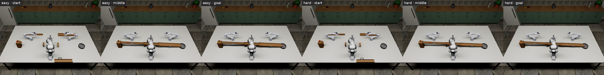

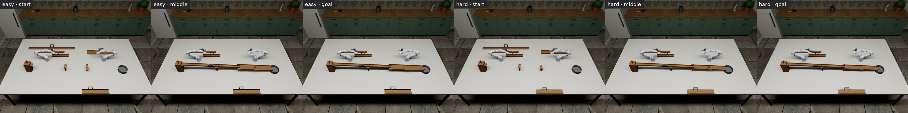

Top views: [exact](media/tasks/Rea-02-top.jpg), [borrow](media/tasks/Rea-02-borrow-top.jpg).

**Instruction.** *"Roll the cherry tomato from the top of the shelf at the west end of the table into the pot at the
east end, along a track laid on the stands. Do not carry it."*

**Arms.** W PiPER, S Franka, E PiPER. **Knob:** the room each side of a channel in its stands' slots, 6 mm (easy) or
3 mm (hard). **Time limit:** 60 s (surplus 90 s, swapped 75 s).

**Facts told.** A channel laid on the stands, or with its lower end inside a wider channel, stays there by itself.
The top of the shelf slopes toward the east; the stop at its edge holds the tomato back. The shelf, the stands and the
pot are fixed to the table. The middle channel lies in a cradle fixed to the table; it comes out only lifted.

**The scene and why one arm is not enough.** Three wooden channels (0.80, 0.55 and 0.80 m long, each wider than the
one before) are to be laid end to end on two stands, every lower end inside the next upper end, so that the tomato,
let go, rolls into the pot. Each channel starts where only one arm reaches it -- the short middle one behind S, no part
of it within the end arms' reach -- and only W reaches the stop at the shelf's edge. Laid, the channels stay put, so no
arm holds anything while the tomato rolls. The cradle closes a route that rakes the middle channel out without S.

**Scripted reference.** E lays the lowest channel, S the middle one, W the upper one; W lifts the stop.

**Success.** The tomato reaches the pot within 5 s of leaving the shelf, never lying on the table, and stays there for
1 s.

**Jobs** (margin 3 cm). Lay the lowest channel; lay the middle channel; lay the upper channel (carries); lift the stop
away (an act). Failure signal: the tomato fell off the track.

| configuration | the table | gold answer |
|---|---|---|
| exact | W S E | W S E |
| surplus | + N Franka at (0, 0.55), facing south | W S E or W S N: N can bring the lowest channel to the table's middle, where S takes it and lays it; E then idle |
| shortfall | S removed | infeasible: lay the middle channel (it lies out of the end arms' reach) |
| swapped | E becomes a Franka | W E: the east Franka reaches the middle channel where it lies and where it is laid, as well as the lowest; S idle |
| borrow | S removed; two grey moulded chutes as wide inside as the upper channel, by W | W E + the 1.30 m chute (the upper and middle channels in one), laid by W from the shelf past the first stand into the lowest channel. The 0.45 m chute ends far short of the lowest channel |

## Rea-03 domino run

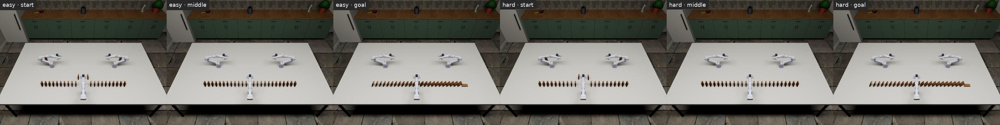

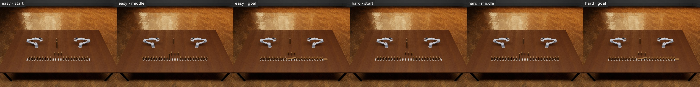

Top views: [exact](media/tasks/Rea-03-top.jpg), [borrow](media/tasks/Rea-03-borrow-top.jpg).

**Instruction.** *"Set the line of dominoes off from its west end so that it falls all the way to its east end."*

**Arms.** W PiPER, S PiPER, E PiPER. **Knob:** the spacing of neighbouring dominoes, 75 mm (easy) or 79 mm (hard).
**Time limit:** 75 s.

**The scene and why one arm is not enough.** A line of 25 wooden dominoes runs 1.8 / 1.9 m down the table, 20 cm in
front of S, with three gaps: the first place, the last, and places 12-14 in the middle; the missing dominoes stand by.
Each gap is within one arm's reach only (all margins hold at least 3 cm), and only W reaches the first place. A domino
stood in its gap stays up, so no arm holds anything while another works. Since the line must be whole when it is set
off, setting its two halves off apart does not count.

**Scripted reference.** The end arms fill the end places, S the middle three, one after another; W tips the first
domino east.

**Success.** The line is whole when the domino on its first place falls, and every domino on it has fallen (tilted
past 15°) for 1 s.

**Jobs** (margin 3 cm). Fill place 1; fill places 12, 13 and 14; fill place 25 (carries); set the line off at its
first place (an act). Failure signal: the run reached the middle stretch and stopped there.

| configuration | the table | gold answer |
|---|---|---|
| exact | W S E | W S E |
| surplus | + N Franka at (0, 0.55), facing south | W S E: N reaches none of the gaps nor the waiting dominoes |
| shortfall | S removed | infeasible: fill places 12-14 (out of the end arms' reach) |
| swapped | S becomes an SO-101 | infeasible: the SO-101 cannot fill places 12 and 14 from the dominoes waiting for them, and no other arm reaches those gaps |
| borrow | S removed; two light wooden slats standing on end by W (place 11 starts empty in this version) | W E + the 30 cm slat: stood by W in place 11, the last it reaches, it falls east across the empty stretch and its top end strikes the domino in place 15, 28.7 cm away. The distractor, by the seed, is 24 cm (it falls into the gap) or 36 cm (its side comes down on that domino's top edge and stays leaning on it) |

## Rea-04 wipe the spills

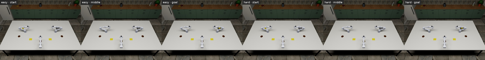

Top view: [exact](media/tasks/Rea-04-top.jpg).

**Instruction.** *"Wipe each of the three coffee spills on the counter with the sponge, keeping it down on each spill
for 1 s, then drop the sponge in the sink at the east end."* At the hard level it names the hard wipe time, 2 s.

**Arms.** W PiPER, S PiPER, E PiPER. **Knob:** how long the sponge must stay down on each spill, 1 s (easy) or 2 s
(hard). **Time limit:** 75 s.

**The scene and why one arm is not enough.** Three spills lie along the counter, one in each arm's part of it, and one
sponge waits on a dish at the far west end; the dish is W's alone and the sink E's alone. The sponge goes from arm to
arm on pads that both neighbouring arms reach, and put down, it stays. The middle spill lies on a 6 cm riser 19 cm in front of
S and 0.87 m from the end arms, out of their reach (margins hold at 8.5 cm, a hand holding the sponge by its end).

**Scripted reference.** W wipes its spill and sets the sponge on pad A; S takes it, wipes the middle spill and sets it
on pad B; E takes it, wipes its spill and drops the sponge in the sink.

**Success.** The sponge stays down on each spill, its middle within 2.5 cm of the spill's, for the wipe time, then lies
in the sink for 1 s and to the end of the run.

**Jobs** (margin 8.5 cm). Wipe the west spill with the sponge from its dish; bring the sponge on from the west spill
and wipe the middle one; bring it on from the middle spill and wipe the east one; bring it on from the east spill into
the sink (carries). Failure signals: the sponge fell off the counter; it was left on a hand-over pad, never taken on.

| configuration | the table | gold answer |
|---|---|---|
| exact | W S E | W S E |
| surplus | + N Franka at (0, 0.55), facing south | W S E: N reaches the sponge but no spill, pad or the sink |
| shortfall | S removed | infeasible: the sponge can be brought neither onto the middle spill nor on from it |
| swapped | E becomes a Franka | W E: holding the sponge by its end, the east Franka reaches the middle spill on the riser 0.86 m out; W wipes its spill and hands the sponge on, E wipes the other two; S idle |
| borrow | S removed; two long-handled sponge brushes by W, each with a clip of two nylon jaws | W E + the brush whose clip fits the sponge: W clips the sponge, lifts it onto the riser and wipes the middle spill with it, then leaves it where E takes it. The distractor's clip is too narrow (refused by the grasp rule) or too wide (it can only push the sponge), by the seed |
